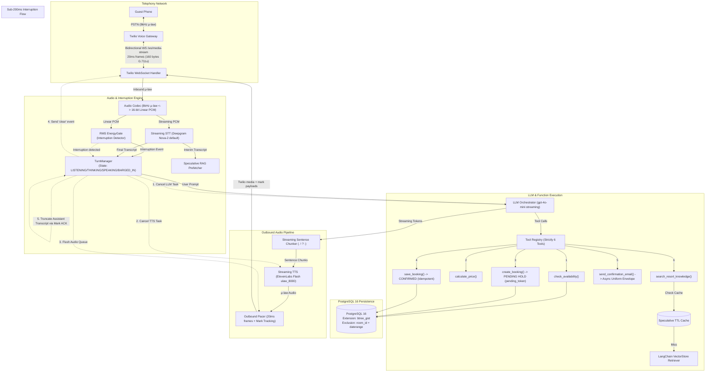

# System Architecture: Production Voice-to-Voice AI Agent for Luxury Resort

## 1. Executive Summary

This system implements a real-time, low-latency, voice-to-voice telephony AI agent designed for luxury resort reservations, guest concierge inquiries, and amenity bookings. 

The architecture enforces strict sub-second Time-to-First-Audio (TTFA) targets, resilient two-stage transactional booking safety backed by PostgreSQL 16 `btree_gist` exclusion constraints, and deterministic sub-200ms barge-in interruption handling.

---

## 2. End-to-End Pipeline Architecture



---

## 3. Audio & Codec Specifications

- **Format**: G.711 μ-law (PCMU) at 8,000 Hz, 8-bit mono.
- **Packet Cadence**: 20 milliseconds per frame.
- **Frame Size**:
  - Encoded μ-law: 160 bytes.
  - Linear PCM (16-bit signed integer): 320 bytes.
- **Payload Format**: Base64-encoded strings wrapped in Twilio Media Stream JSON envelopes.

---

## 4. The Six Agent Tools

1. **`check_availability(room_type, check_in, check_out, guests)`**: Queries DB for unreserved rooms in range.
2. **`calculate_price(room_id, check_in, check_out, add_ons)`**: Computes subtotal, taxes (12%), resort fees ($45/night), and add-on costs.
3. **`create_booking(...)`**: Inserts a booking with status `pending`, generates a signed `pending_token` with 15-minute TTL.
4. **`save_booking(pending_token)`**: Idempotently commits the booking status from `pending` to `confirmed`.
5. **`send_confirmation_email(booking_id, customer_email)`**: Validates booking existence and customer email, returns uniform envelope `{"ok": bool, "data": ..., "spoken_hint": ...}`, enqueuing async delivery.
6. **`search_resort_knowledge(query, top_k)`**: Probes the speculative prefetch cache before executing LangChain vector retrieval.

---

## 5. Concurrency & Data Integrity

- **Database Engine**: PostgreSQL 16.
- **Extension**: `btree_gist`.
- **Constraint**:
  ```sql
  ALTER TABLE bookings ADD CONSTRAINT no_overlapping_bookings
  EXCLUDE USING gist (
      room_id WITH =,
      daterange(check_in, check_out, '[)') WITH &&
  )
  WHERE (status IN ('pending', 'confirmed'));
  ```
- Overlapping bookings for the same room raise SQLSTATE `23P01` (`exclusion_violation`).
