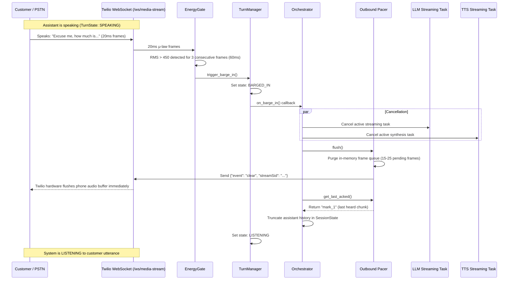

# Telephony Voice Pipeline & Interruption Engineering

## 1. Frame Slicing & Audio Codecs

The telephony subsystem strictly adheres to the standard PSTN/Twilio G.711 μ-law (PCMU) standard:
- **Sample Rate**: 8,000 Hz
- **Bit Depth**: 8-bit non-linear logarithmic encoding (G.711u)
- **Channels**: 1 (Mono)
- **Frame Interval**: 20 milliseconds per packet (~50 packets/sec)
- **Packet Size**: Exactly 160 bytes of μ-law audio per frame
- **Linear PCM Equivalence**: 16-bit linear signed integers (little-endian), 320 bytes per 20ms frame

```
Inbound (Twilio -> App):
[20ms Base64 payload in WS 'media' event]
    │
    ▼ (base64.b64decode)
[160 bytes G.711 μ-law]
    │
    ├──► [EnergyGate]: Converts to 320 bytes PCM -> Computes RMS energy
    └──► [Streaming STT]: Piped into Deepgram WebSocket stream
```

---

## 2. RMS EnergyGate & Interruption Detection

Interruption onset detection is performed locally on the raw 20ms frames to achieve sub-200ms interruption latency without waiting for cloud STT endpointing:
1. Every 20ms frame is converted to linear PCM samples ($s_i$).
2. The Root Mean Square (RMS) energy is computed:
   $$\text{RMS} = \sqrt{\frac{1}{N} \sum_{i=1}^{N} s_i^2}$$
3. Background noise floor is tracked using an exponential moving average:
   $$\text{NoiseFloor}_{t} = \alpha \cdot \text{NoiseFloor}_{t-1} + (1 - \alpha) \cdot \text{RMS}_t \quad (\alpha = 0.95)$$
4. If $\text{RMS} > 450$ for **3 consecutive frames (60ms)** while the TurnManager is in `SPEAKING` state:
   - EnergyGate immediately raises an interruption signal to the `TurnManager`.

---

## 3. Sub-200ms Barge-In Cancellation Flow

When an interruption is confirmed, the system executes this cancellation sequence:



---

## 4. Mark Tracking & Transcript Truncation

Twilio Media Streams support `mark` events to know when packets are actually heard by the guest:
1. The `OutboundPacer` groups sentences into chunked audio bursts.
2. Every 15 frames (300ms) or at the end of a sentence chunk, the pacer sends:
   ```json
   {"event": "mark", "streamSid": "...", "mark": {"name": "mark_1"}}
   ```
3. When Twilio finishes playing those frames to the caller's phone, it returns:
   ```json
   {"event": "mark", "streamSid": "...", "mark": {"name": "mark_1"}}
   ```
4. On barge-in, `SessionState.truncate_on_barge_in(last_acked_mark)` retains only the sentences acknowledged up to that mark. Sentences queued after that mark are discarded, ensuring the LLM's conversation history reflects what the guest actually heard.
